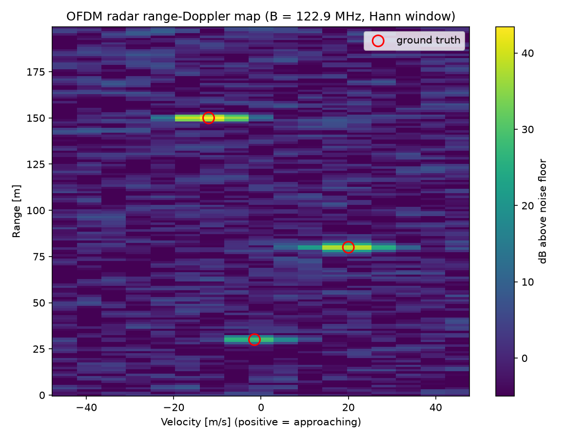
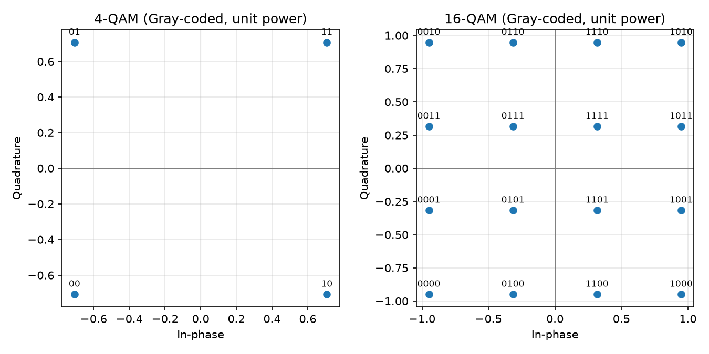
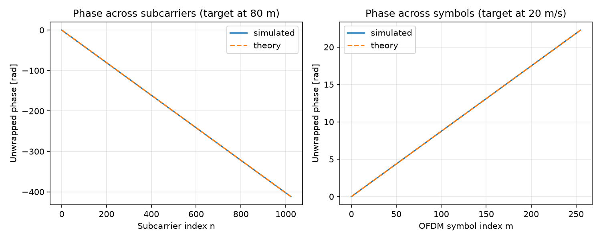
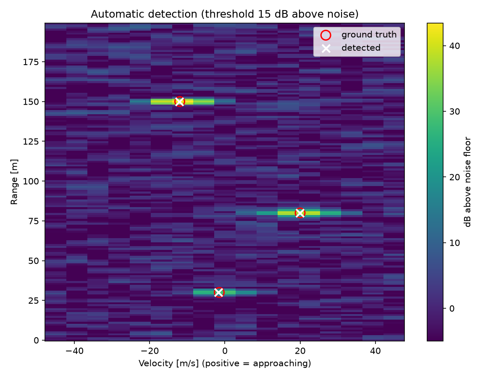
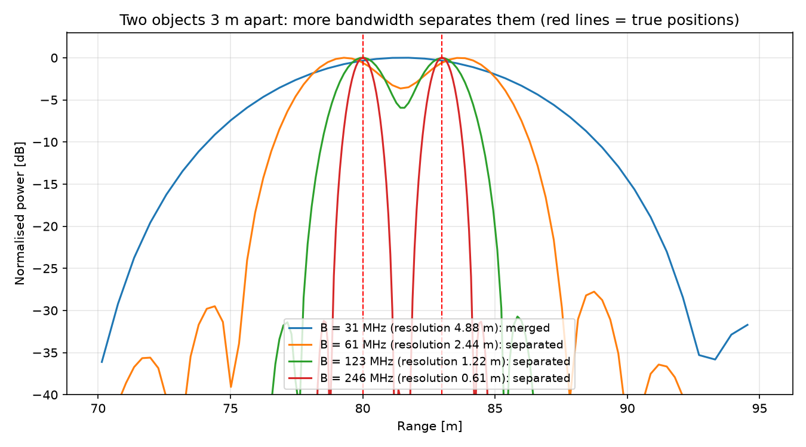
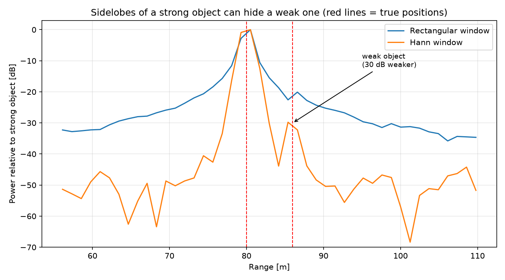
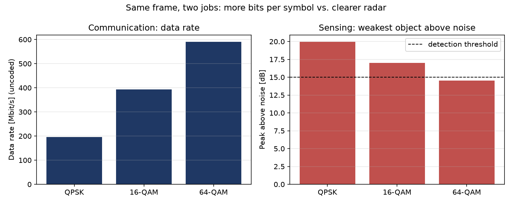

# OFDM ISAC Radar

**One radio signal, two jobs:** this project shows how a mobile network signal can carry data *and* work as a radar at the same time. This idea is called **integrated sensing and communication (ISAC)**, and it is one of the main research topics for 6G.

The simulation is written in Python. A base station sends a normal OFDM signal (the kind used in 4G, 5G and Wi-Fi), the signal bounces off objects, and the base station uses the echoes to find **how far away** each object is and **how fast** it is moving. The same signal is also decoded by a user as data.



*A map of distance vs speed. Each bright spot is a detected object, and the red circles mark where the objects really are.*

---

## Key findings

| Question | Result |
|---|---|
| Can the radar find objects whose echoes are weaker than the noise? | Yes. Combining the whole frame adds 54 dB of processing gain, so all objects stand out 29 to 44 dB above the noise. |
| How accurate is it? | Distance within **2 cm** and speed within **0.2 m/s**, although one FFT bin is 1.22 m and 5.6 m/s wide. |
| What decides whether two close objects can be separated? | **Bandwidth.** Two objects 3 m apart merge at 31 MHz but separate clearly at 123 MHz. |
| Why use a window? | Without it, a car's sidelobes **hide a pedestrian** and create **6 fake objects**. With a Hann window, both are found with no false alarms. |
| What is the cost of sending more data? | 64-QAM triples the data rate compared with QPSK, but makes the radar 4.3 dB noisier, enough to **miss the pedestrian**. |

---

## The idea in four steps

1. **Send:** the base station sends an OFDM frame filled with data.
2. **Bounce:** each object reflects part of the signal back.
   - A **farther** object returns the echo **later**.
   - A **moving** object slightly **shifts the frequency** of the echo (the Doppler effect).
3. **Remove the data:** the base station knows exactly what it sent, so it removes the data from the echo. Only the effect of the objects is left.
4. **Two FFTs:** one FFT turns the delay into a **distance**, and another turns the frequency shift into a **speed**.

```
Data → OFDM frame → [ objects reflect the signal ] → remove data → FFT → FFT → distance-speed map
            └──────→ [ user decodes the same frame as data ]
```

---

## System settings

The settings are similar to a future 6G system in the 7–24 GHz band.

| Setting | Value |
|---|---|
| Carrier frequency | 10 GHz |
| Bandwidth | 122.88 MHz |
| Subcarriers | 1024, spaced 120 kHz apart |
| OFDM symbols per frame | 256 (one frame lasts 2.7 ms) |
| Modulation | QPSK (16-QAM and 64-QAM also tested) |

### What the radar can do with these settings

| Capability | Value | What decides it |
|---|---|---|
| Smallest distance between two objects it can separate | 1.22 m | More bandwidth means finer distance |
| Smallest speed difference it can separate | 5.6 m/s | A longer frame means finer speed |
| Maximum distance (simple model) | about 312 m | Length of the cyclic prefix |

---

## Results

### 1. The data signal



The data is mapped onto QPSK and 16-QAM symbols. Neighbouring points differ in only one bit (Gray coding), and decoding the clean signal gives **0 bit errors**.

### 2. Checking the echo model



An object at 80 m moving at 20 m/s leaves two simple patterns in the signal: one across frequency (distance) and one across time (speed). The simulation matches theory exactly, and the estimated values come out as **80.00 m and 20.00 m/s**.

### 3. Finding objects in noise

| Object | Distance | Speed | Strength of the spot |
|---|---|---|---|
| Pedestrian | 30 m | walking away at 1.5 m/s | 29 dB above noise |
| Car | 80 m | approaching at 20 m/s | 38.5 dB above noise |
| Truck | 150 m | driving away at 12 m/s | 43.5 dB above noise |

Before processing, each echo was weaker than the noise. The FFTs add up the whole frame, about 262,000 values, which makes the objects stand out clearly.

### 4. Automatic detection



The radar finds the objects by itself: a spot counts as an object if it is the highest point in its area and more than 15 dB above the noise. All 3 objects were found, with no false alarms.

| Object | True distance | Measured | True speed | Measured |
|---|---|---|---|---|
| Pedestrian | 30.00 m | 29.98 m | −1.50 m/s | −1.70 m/s |
| Car | 80.00 m | 79.98 m | +20.00 m/s | +19.95 m/s |
| Truck | 150.00 m | 149.99 m | −12.00 m/s | −12.12 m/s |

**Resolution vs accuracy:** the radar can only *separate* objects that are at least 1.22 m apart, but it can *locate* a single object much more precisely, here to within 2 cm, by interpolating between FFT bins.

### 5. More bandwidth separates close objects



Two objects 3 m apart, measured with four bandwidths:

| Bandwidth | Resolution | Result |
|---|---|---|
| 31 MHz | 4.88 m | Merged: seen as one object |
| 61 MHz | 2.44 m | Just separated, positions slightly off |
| 123 MHz | 1.22 m | Clearly separated, correct positions |
| 246 MHz | 0.61 m | Fully separated |

In practice the resolution is a bit worse than the formula c/2B, because the window that suppresses sidelobes also widens each peak. This is why 6G research looks at bands with much more bandwidth, such as 7–24 GHz and above 100 GHz.

### 6. Windowing reveals weak objects



A car and a pedestrian (30 dB weaker) are 6 m apart. The same signal is processed with and without a window:

| | No window | Hann window |
|---|---|---|
| Pedestrian found | No | Yes |
| False alarms | 6 | 0 |

Without a window, the car's sidelobes are strong enough to hide the pedestrian and to create fake objects. The Hann window lowers the sidelobes from −13 dB to about −31 dB, so both objects are found correctly. The price is slightly wider peaks.

### 7. The trade-off between data and sensing



The same frame is decoded by a user (communication) and used as radar (sensing):

| Modulation | Data rate | Bit error rate | Radar noise increase | Objects found |
|---|---|---|---|---|
| QPSK | 197 Mbit/s | 0 | 0 dB | 3 of 3 |
| 16-QAM | 393 Mbit/s | 3.8 × 10⁻⁶ | 2.8 dB | 3 of 3 |
| 64-QAM | 590 Mbit/s | 8.5 × 10⁻³ | 4.3 dB | 2 of 3 (pedestrian missed) |

Higher-order QAM packs more bits into each symbol, but some of its symbols have small amplitudes. When the radar divides by those small values, the noise grows. The simulated bit error rates match theory. This is the central design question in ISAC: **how much data rate to give up for better sensing.**

---

## Simplifications

This is a simulation, so some real-world effects are left out for now:
- Objects are single points that don't change distance or speed during one frame.
- The base station can transmit and receive at the same time without disturbing itself.
- Only random noise is added. There are no hardware errors such as phase noise or IQ imbalance.

---

## How to run

```bash
git clone https://github.com/DheerenDD/ofdm-radar.git
cd ofdm-radar
python3 -m venv .venv && source .venv/bin/activate
pip install -r requirements.txt

python main.py      # runs every step and experiment, saves all figures to results/
```

Each part can also be run on its own, for example `python -m isac.detection` or `python -m experiments.windowing`.

### Files

| File | What it does |
|---|---|
| `isac/params.py` | System settings and what the radar can measure |
| `isac/frame.py` | Turns bits into the OFDM data frame, and back |
| `isac/targets.py` | Simulates the echoes from objects |
| `isac/processing.py` | Removes the data and creates the distance-speed map |
| `isac/detection.py` | Finds objects automatically and compares them with the truth |
| `experiments/resolution_vs_bandwidth.py` | How bandwidth affects separating close objects |
| `experiments/windowing.py` | How windowing reveals weak objects |
| `experiments/qam_tradeoff.py` | Data rate vs radar quality for QPSK, 16-QAM and 64-QAM |
| `main.py` | Runs everything in order |

---

## Next steps

- [x] Data frame, echo model and distance-speed map
- [x] Find objects automatically and compare with their true positions
- [x] Show how bandwidth affects how well close objects can be separated
- [x] Show how windowing helps reveal weak objects next to strong ones
- [x] Compare QPSK, 16-QAM and 64-QAM: the trade-off between data and sensing
- [ ] Add hardware effects such as phase noise and IQ imbalance
- [ ] Run it on real radio hardware, such as a software-defined radio

---

**Reference:** C. Sturm and W. Wiesbeck, "Waveform Design and Signal Processing Aspects for Fusion of Wireless Communications and Radar Sensing," *Proceedings of the IEEE*, 2011.

**Author:** Dheerendranath Dadige, M.Eng. Information Technology, SRH Hochschule Heidelberg
